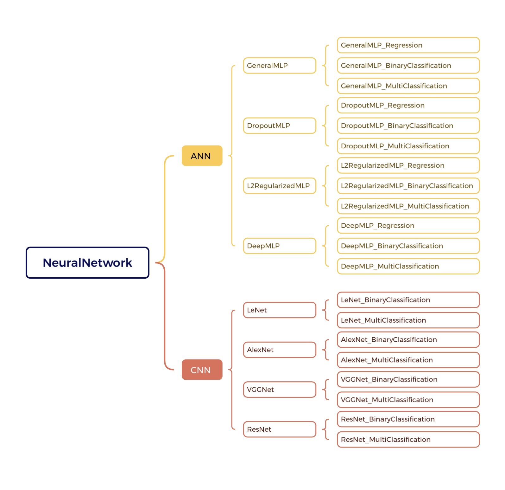

# NNMTMPlatform

NNMTMPlatform 是一个本地运行的神经网络训练与模型管理工具，使用 C++17、Qt 6 Widgets、LibTorch 和 OpenCV 开发。项目始于大一课程设计，现已整理为不依赖 Visual Studio IDE 的 CMake 工程。

> 当前主要支持 Windows + MSVC；无需安装或打开 Visual Studio IDE，但需要 Visual Studio Build Tools 提供编译器。

## 功能

- 数值回归、数值二分类和数值多分类
- 图像二分类和图像多分类
- ANN/CNN 模型的训练、测试与推理
- 训练轮数、批次大小和学习率配置
- CPU/CUDA 自动选择与运行时验证
- 模型元数据、权重、归一化参数和标签映射的本地保存
- 训练损失曲线、回归分析和分类分析界面
- 模型搜索、筛选、草稿箱和回收站



## 支持的模型

| 数值模型 | 图像模型 |
| --- | --- |
| SimpleMLP | LeNet |
| GeneralMLP | AlexNet |
| DropoutMLP | VGGNet |
| L2RegularizedMLP | ResNet |
| DeepMLP | |
| SuperDeepMLP | |

## 快速开始

需要 CMake 3.24+、Ninja、MSVC Build Tools、Qt 6（Core/Gui/Widgets/Charts）、LibTorch 和 OpenCV（core/imgproc/imgcodecs）。

1. 复制 `CMakeUserPresets.example.json` 为 `CMakeUserPresets.json`。
2. 把其中的 Qt、LibTorch、vcpkg 和 Ninja 路径改为本机路径。
3. 打开“x64 Native Tools Command Prompt for VS 2022”，在项目根目录运行：

```powershell
cmake --preset local-windows-release
cmake --build --preset local-windows-release
ctest --test-dir build/local-windows-release --output-on-failure
```

程序位于 `build/local-windows-release/NNMTMPlatform.exe`。CMake 会同时部署需要的 Qt、OpenCV 和 LibTorch 运行库。也可用 Qt Creator 直接打开根目录的 `CMakeLists.txt`。

详细环境配置和常见问题见 [Windows 构建指南](docs/BUILDING.zh-CN.md)。

## 数据集格式

数值任务使用空格分隔的 `.txt` 文件，图像任务使用“每个子目录代表一个类别”的目录结构。可直接使用 [examples](examples/README.md) 中的小型数值数据快速试用。

完整规则见 [数据格式说明](docs/DATA_FORMAT.zh-CN.md)。

CNN 只保存排序后的图片路径和标签，训练、验证及推理时按批次解码，不会一次性将整个数据集载入内存。无法解码的图片会报告具体路径并安全停止。

## CUDA

使用 CUDA 版 LibTorch 构建时，程序会在训练、测试和推理前执行 CUDA 运算检查。成功后使用 `CUDA:0`，否则自动回退至 CPU。

```powershell
$env:NNMTM_DEVICE = "cpu"   # 强制 CPU
$env:NNMTM_DEVICE = "cuda"  # 强制 CUDA，不可用时直接报错
```

显卡架构未被正确识别时，可在本机 `CMakeUserPresets.json` 中设置 `TORCH_CUDA_ARCH_LIST`。该文件不会提交到 Git。

## 测试

| 测试 | 内容 |
| --- | --- |
| `core_logic` | 随机划分、分层划分和输入校验 |
| `cuda_runtime` | LibTorch CUDA 运算与 Adam 参数更新 |
| `ann_pipeline` | ANN 训练、保存、重载和推理 |
| `cnn_pipeline` | CNN 分批读图、CUDA 训练、重载和推理 |

GitHub Actions 会在每次提交和 Pull Request 上运行不依赖大型第三方库的 `core_logic` 检查。完整图形界面和 LibTorch 测试在本机运行。

## 目录结构

```text
src/app/                 程序入口
src/ui/                  Qt 界面
src/core/                模型元数据、持久化与后台任务
src/models/              神经网络、ANN 和 CNN 实现
resources/images/        项目图片资源
docs/                    使用文档和原课程资料
examples/                可提交的小型示例数据
tests/                   自动化测试
legacy/visual-studio/    仅供参考的原 Visual Studio 工程
```

## 本地文件

完整训练集、模型权重、模型元数据和构建产物都被 `.gitignore` 排除。它们仍保留在本地，不会因 Git 或 CMake 迁移而被删除。

## 项目性质与许可证

这是一个课程设计的现代化整理版，主要用于学习和作品展示，不是生产级机器学习平台。

当前尚未选择开源许可证。在添加明确许可证之前，本项目不授予复制、修改或再分发权利。
